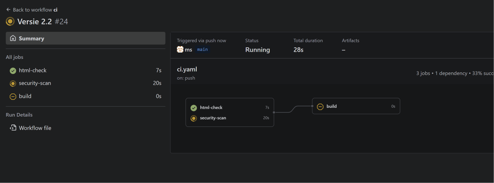
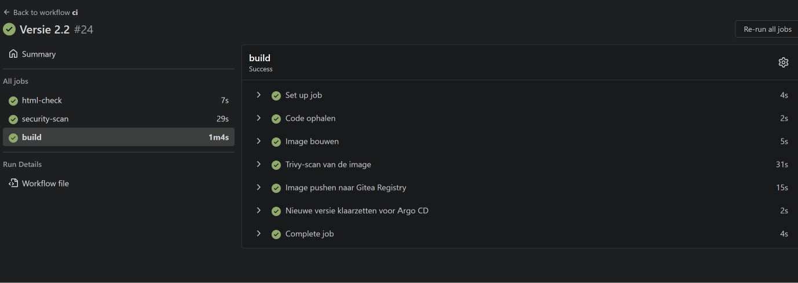
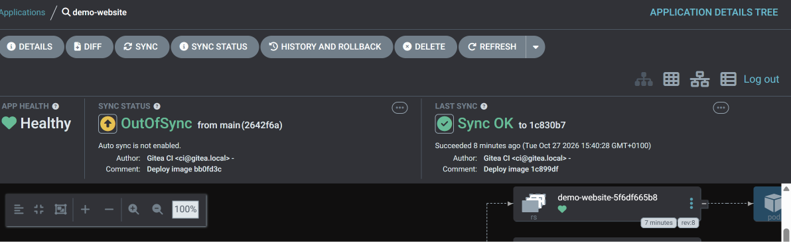
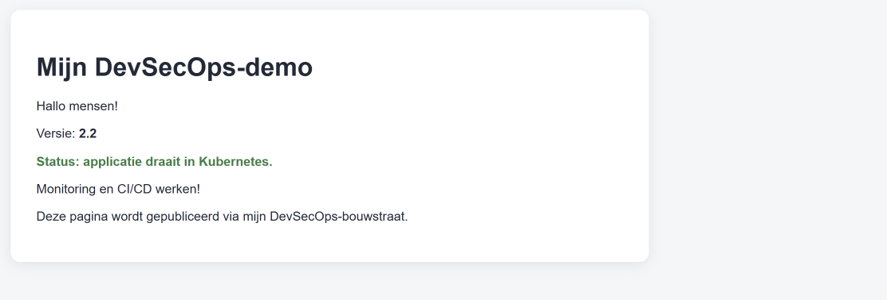
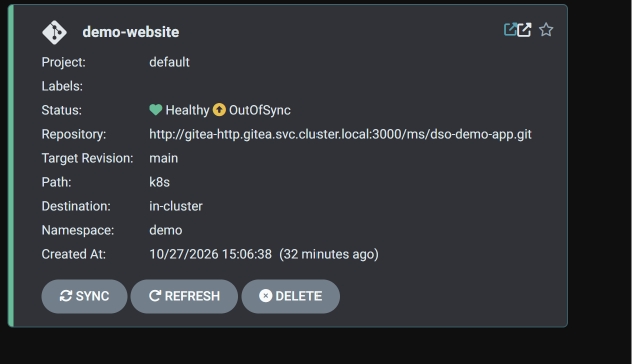
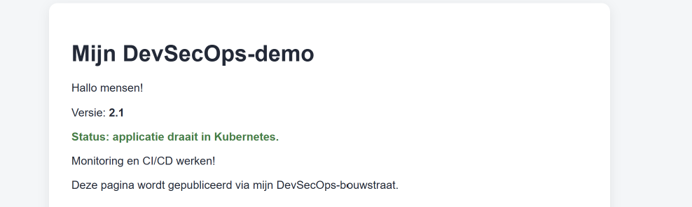
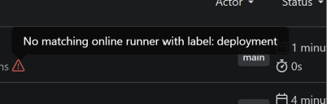
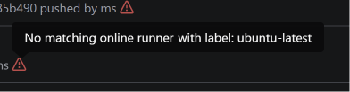

# Portfolio DSO-bouwstraat

**Student:** Michyl Stuurop
**Opdracht:** Assignment 2: DSO-bouwstraat
**Omgeving:** k3s op een Ubuntu-VM in Proxmox

---

## Inhoudsopgave

1. [Inleiding](#1-inleiding)
2. [Architectuur en infrastructuur](#2-architectuur-en-infrastructuur)
3. [Basisonderdeel 1: Versiebeheer met CI/CD-tooling](#3-basisonderdeel-1-versiebeheer-met-cicd-tooling)
4. [Basisonderdeel 2: Fasering Build en Deploy met handmatige validatie](#4-basisonderdeel-2-fasering-build-en-deploy-met-handmatige-validatie)
5. [Basisonderdeel 3: Gehoste webapplicatie](#5-basisonderdeel-3-gehoste-webapplicatie)
6. [Basisonderdeel 4: Monitoring van de applicatie](#6-basisonderdeel-4-monitoring-van-de-applicatie)
7. [Basisonderdeel 5: Monitoring van het buildproces](#7-basisonderdeel-5-monitoring-van-het-buildproces)
8. [Basisonderdeel 6: Monitoring van de infrastructuur](#8-basisonderdeel-6-monitoring-van-de-infrastructuur)
9. [Aanvullende onderdelen](#9-aanvullende-onderdelen)
   - [9.1 Security-pipeline: SAST, DAST, SBOM en configuratievalidatie](#91-security-pipeline-sast-dast-sbom-en-configuratievalidatie)
   - [9.2 Hardening op basis van de scanresultaten](#92-hardening-op-basis-van-de-scanresultaten)
   - [9.3 Vals-groen: scans die niets scanden](#93-vals-groen-scans-die-niets-scanden)
10. [De volledige keten: demoscenario met bewijs](#10-de-volledige-keten-demoscenario-met-bewijs)
11. [Opgeloste problemen](#11-opgeloste-problemen)
12. [Overzicht configuratiebestanden](#12-overzicht-configuratiebestanden)
13. [Reflectie en vervolgstappen](#13-reflectie-en-vervolgstappen)

---

## 1. Inleiding

In dit portfolio beschrijf ik hoe ik mijn DSO-bouwstraat heb gebouwd. Per basisonderdeel leg ik uit **wat** ik gebruik, **hoe** het werkt en **welk bewijs** er is.

| # | Basisonderdeel | Mijn implementatie |
|---|---|---|
| 1 | Versiebeheer met CI/CD | Gitea met Gitea Actions (CI) en Argo CD (CD) |
| 2 | Build en Deploy met handmatige validatie | Build: CI bouwt en scant een container-image. Deploy: Argo CD met een handmatige **Sync** |
| 3 | Gehoste webapplicatie | NGINX-website als eigen container-image in Kubernetes |
| 4 | Monitoring van de applicatie | Prometheus Blackbox Exporter |
| 5 | Monitoring van het buildproces | Gitea Actions, Argo CD-overzicht en Grafana |
| 6 | Monitoring van de infrastructuur | Prometheus, Node Exporter, kube-state-metrics en Grafana |

Daarnaast heb ik een aantal aanvullende onderdelen gerealiseerd: GitOps met Argo CD, rollback, vulnerability scans en een container registry. Zie [hoofdstuk 9](#9-aanvullende-onderdelen).

---

## 2. Architectuur en infrastructuur

Alles draait op één virtuele machine in Proxmox. Op die VM draait **k3s**, een lichtgewicht Kubernetes-distributie. Ik heb voor k3s gekozen omdat het weinig resources gebruikt en toch volledige Kubernetes is. Alles wordt beheerd met YAML-bestanden en Helm.

| Onderdeel | Waarde |
|---|---|
| Virtualisatie | Proxmox |
| Besturingssysteem | Ubuntu Server 24.04.5 LTS |
| Resources | 4 vCPU, 15 GiB RAM, 57 GB disk |
| Kubernetes | k3s v1.36.5 (single-node) |
| Ingress | Traefik (standaard in k3s) |
| IP-adres | `10.24.20.224` |

### Namespaces

| Namespace | Inhoud |
|---|---|
| `gitea` | Gitea, PostgreSQL en Valkey (cache) |
| `ci` | Gitea Actions-runner (Docker-in-Docker) |
| `argocd` | Argo CD (GitOps-deployment) |
| `demo` | De webapplicatie (productie) |
| `monitoring` | Prometheus, Grafana, Blackbox Exporter, Node Exporter en kube-state-metrics |

### Bereikbaarheid

Traefik routeert het verkeer op basis van de hostnaam. Ik gebruik `sslip.io`, zodat ik geen eigen DNS-server nodig heb: de hostnaam wijst automatisch naar het IP-adres dat erin staat.

| Applicatie | URL |
|---|---|
| Gitea (+ Container Registry) | http://gitea.10.24.20.224.sslip.io |
| Argo CD | http://argocd.10.24.20.224.sslip.io |
| Website (productie) | http://demo.10.24.20.224.sslip.io |
| Grafana | http://grafana.10.24.20.224.sslip.io |

### Overzicht

```text
                            Proxmox-VM (Ubuntu 24.04)
┌──────────────────────────────────────────────────────────────────────────┐
│ k3s                                                                      │
│                                                                          │
│  Traefik ──► gitea.…    ──► [gitea]      Gitea + Actions + Registry      │
│          ──► argocd.…   ──► [argocd]     Argo CD                         │
│          ──► demo.…     ──► [demo]       Website (eigen image)           │
│          ──► grafana.…  ──► [monitoring] Grafana                         │
│                                                                          │
│  [ci]         gitea-runner (DinD): test, scan, build, push               │
│                                                                          │
│  [argocd]     Argo CD ──leest── Git (k8s/) ──► past [demo] aan na Sync   │
│                                                                          │
│  [monitoring] Prometheus ◄── Node Exporter (VM)                          │
│                          ◄── kube-state-metrics (Kubernetes)             │
│                          ◄── Blackbox Exporter ──► website               │
│                          ◄── Argo CD-metrics                             │
└──────────────────────────────────────────────────────────────────────────┘
```

---

## 3. Basisonderdeel 1: Versiebeheer met CI/CD-tooling

### Wat gebruik ik?
| Taak | Tool |
|---|---|
| Versiebeheer | **Gitea 1.27**, self-hosted in Kubernetes |
| CI (testen, scannen, bouwen) | **Gitea Actions** |
| Opslag van images | **Gitea Container Registry** (ingebouwd in Gitea) |
| CD (uitrollen naar productie) | **Argo CD** |

### Hoe werkt het?
De code staat in de repository **`ms/dso-demo-app`**:

```text
dso-demo-app/
├── index.html                 ← de website
├── Dockerfile                 ← bouwt de website als NGINX-image
├── k8s/                       ← gewenste toestand van productie (Argo CD leest dit)
│   ├── deployment.yaml
│   ├── service.yaml
│   └── ingress.yaml
├── argocd/application.yaml    ← koppeling Argo CD ↔ repo
└── .gitea/workflows/ci.yaml   ← CI-pipeline
```

- Gitea gebruikt PostgreSQL als database en Valkey als cache. De data staat op persistent volumes, zodat er niets verloren gaat als een pod herstart.
- Gitea Actions gebruikt dezelfde workflow-syntax als GitHub Actions.
- De workflows worden uitgevoerd door een **runner** in namespace `ci`. Ik gebruik de image `gitea/runner:2.3-dind` (Docker-in-Docker). Elke job draait daardoor in een eigen, schone container, en Docker hoeft niet op de VM zelf geïnstalleerd te zijn.

### Waarom Argo CD voor de CD?
Eerst rolde een tweede runner de website uit met `kubectl` en een Kubernetes-token (*push*-model). Dat heb ik vervangen door Argo CD (*pull*-model, GitOps):

| | Push (eerst) | GitOps met Argo CD (nu) |
|---|---|---|
| Wie past productie aan? | Een CI-runner met een token | Argo CD, vanuit het cluster zelf |
| Bron van waarheid | Wat de laatste workflow deed | **Git** (`k8s/`) |
| Cluster-toegang buiten Kubernetes nodig? | Ja (token in Gitea) | Nee |
| Rollback | Handmatig opnieuw deployen | Eén klik in Argo CD |

---

## 4. Basisonderdeel 2: Fasering Build en Deploy met handmatige validatie

```text
 BUILD (automatisch, Gitea Actions)                                    DEPLOY (handmatig, Argo CD)
 ┌────────────────────────────────────────────────────────────────┐    ┌──────────────────────────┐
 │ html-check ────────┐                                           │    │ Argo CD: OutOfSync       │
 │ sast (Semgrep) ────┤             ┌─► sbom (Syft) ───┐          │    │      │                   │
 │ secret-vuln-scan ──┼─► build ────┤                  ├─► release│Git │ ► mens klikt SYNC ◄      │
 │ config-validation ─┘  + Trivy    └─► dast (ZAP) ────┘   push + │──► │      │                   │
 │                         image                           tag    │    │ nieuwe versie live       │
 └────────────────────────────────────────────────────────────────┘    └──────────────────────────┘
```

### Fase 1: Build (`ci.yaml`), automatisch

De CI start automatisch bij elke push naar `main` en bij elke pull request. Er zijn drie stappen.

**Stap 1: broncode controleren** (4 jobs, parallel)

| Job | Wat gebeurt er |
|---|---|
| `html-check` | Controleert of `index.html` bestaat, de titel bevat en een versievermelding heeft |
| `sast` | **Semgrep** scant de broncode, Dockerfile, k8s-manifests en workflows |
| `secret-vuln-scan` | **Trivy** zoekt naar gelekte geheimen en kwetsbare dependencies |
| `config-validation` | **Trivy config** controleert Dockerfile en k8s-manifests op onveilige instellingen |

**Stap 2: image bouwen en testen** (start alleen als stap 1 helemaal groen is)

| Job | Wat gebeurt er |
|---|---|
| `build` | Bouwt de image met de commit-hash als tag (bijvoorbeeld `dso-demo-app:b2d13df`). Daarna scant Trivy de **image** en faalt bij `CRITICAL` |
| `sbom` | **Syft** maakt een Software Bill of Materials (SPDX) en bewaart die als bijlage bij de run |
| `dast` | Start de image zoals in productie en scant hem met **OWASP ZAP** |

**Stap 3: release** (alleen als sbom én dast geslaagd zijn)
1. pusht de image naar de **Gitea Container Registry**;
2. zet de nieuwe tag in `k8s/deployment.yaml` en commit dat naar Git.

Een image die door één van de scans valt, komt dus **nooit** in de registry, en dus ook nooit in productie.

Elke versie is daardoor een **vast, onveranderlijk artefact**, te herleiden tot een commit. Een commit van de CI die alleen `k8s/` wijzigt, start geen nieuwe CI (`paths-ignore: k8s/**`). Zo ontstaat er geen oneindige lus.


*De build-job wacht tot html-check en security-scan klaar zijn.*


*Alle stappen van de build-job geslaagd: bouwen, image-scan, push en tag klaarzetten.*

### Fase 2: Deploy (Argo CD), handmatige validatie

Argo CD vergelijkt continu de **gewenste toestand** (de map `k8s/` in Git) met de **werkelijke toestand** in het cluster. Zet de CI een nieuwe image-tag in Git, dan meldt Argo CD **OutOfSync**.

**Auto-sync staat bewust uit.** Een nieuwe versie gaat pas naar productie als iemand in Argo CD:
1. met **App Diff** bekijkt wat er verandert (welke image-tag);
2. op **Sync** klikt.

**Dit is de handmatige validatie.** Er kan alleen een image worden uitgerold die door de volledige CI is gekomen, want zonder geslaagde build komt er geen nieuwe tag in Git.


*Argo CD toont "OutOfSync" met de nieuwe commit van de CI ("Deploy image bb0fd3c"). Auto sync is not enabled: er wacht een handmatige goedkeuring.*

### Beveiliging van deze fasering
- **Tokens met minimale rechten:**
  - `CI_TOKEN` (repository en package **schrijven**) wordt alleen door de CI gebruikt.
  - Een apart **alleen-lezen**-token wordt gebruikt door Argo CD (repo lezen) en k3s (images ophalen).
- Tokens staan in **Gitea Secrets** en **Kubernetes Secrets**, nooit in de code.
- Argo CD leest Git via het **interne cluster-adres** van Gitea. Er is geen cluster-token meer nodig buiten Kubernetes.

---

## 5. Basisonderdeel 3: Gehoste webapplicatie

### Wat gebruik ik?
Een eigen demo-website, verpakt als **container-image** op basis van `nginx-unprivileged`. Die draait zonder root-rechten:

```dockerfile
FROM nginxinc/nginx-unprivileged:alpine
COPY nginx/default.conf /etc/nginx/conf.d/default.conf
COPY index.html style.css /usr/share/nginx/html/
USER 101
```

`nginx/default.conf` voegt security-headers toe en verbergt de nginx-versie (zie [9.2](#92-hardening-op-basis-van-de-scanresultaten)).

### Hoe werkt het?
De website draait in namespace `demo` en bestaat uit drie Kubernetes-resources, alle drie beheerd door Argo CD vanuit `k8s/`:

| Resource | Functie |
|---|---|
| Deployment `demo-website` | Start de pod met de gebouwde image als **gebruiker 101, read-only**, zonder Linux-capabilities. Heeft readiness- en livenessProbes en **resource-limieten** |
| Service `demo-website` | Vast intern adres voor de pod |
| Ingress `demo-website` | Maakt de site bereikbaar op `demo.10.24.20.224.sslip.io` |

k3s haalt de image op uit de Gitea Container Registry. Inloggen gebeurt met het alleen-lezen-token in `/etc/rancher/k3s/registries.yaml`.

De website toont het **versienummer**. Zo is direct te zien welke versie in productie draait.



---

## 6. Basisonderdeel 4: Monitoring van de applicatie

### Wat gebruik ik?
De **Prometheus Blackbox Exporter**, geïnstalleerd met Helm in namespace `monitoring`.

### Hoe werkt het?
De Blackbox Exporter bekijkt de website **van buitenaf**, zoals een gebruiker dat doet. Prometheus vraagt de exporter regelmatig om `http://demo.10.24.20.224.sslip.io` op te vragen. De exporter meldt dan of dat lukt en hoe lang het duurt.

```text
Prometheus ──► Blackbox Exporter ──HTTP GET──► demo-website
     ▲                │
     └── probe_success = 1 / 0, responstijd, statuscode
```

Dit is ingesteld als extra scrape-job `blackbox-demo-website` met de module `http_2xx`. De check slaagt alleen bij een HTTP-statuscode in de 200-reeks.

| `probe_success` | Betekenis |
|---|---|
| `1` | Website bereikbaar en geeft een geldige respons |
| `0` | Website onbereikbaar of foutmelding |

**Waarom deze aanpak?** Een pod kan in Kubernetes op *Running* staan terwijl de website toch niet werkt, bijvoorbeeld door een fout in de Ingress. De Blackbox Exporter test de hele route: Traefik → Service → Pod → NGINX.

> 📸 **Bewijs:** Grafana → Explore → query `probe_success{job="blackbox-demo-website"}` met waarde 1

---

## 7. Basisonderdeel 5: Monitoring van het buildproces

Ik monitor het build- en deployproces op drie plekken:

**1. Gitea Actions: de build**
- Elke run is te zien met status (geslaagd, mislukt of bezig), commit, auteur en duur.
- De grafische weergave laat de afhankelijkheden zien: `build` wacht op `html-check` en `security-scan`.
- Per stap is de volledige log te bekijken, inclusief het Trivy-rapport. Zo is direct te zien wat er misgaat. Een voorbeeld staat in hoofdstuk 11 (*"password is empty"*).

**2. Argo CD: de deployment**
- Toont per applicatie de **sync-status** (Synced of OutOfSync) en de **health** (Healthy, Degraded of Progressing).
- Toont welke commit live staat en welke commit klaarstaat, met de auteur ("Gitea CI") en het commit-bericht ("Deploy image …").
- De boomweergave toont alle Kubernetes-objecten: Deployment, ReplicaSet en Pod.
- Argo CD-metrics worden via een ServiceMonitor door **Prometheus** opgehaald.



**3. Grafana: de build-infrastructuur**
- Het dashboard *Kubernetes / Compute Resources / Namespace (Pods)* met namespace `ci` laat het CPU- en geheugengebruik van de runner zien. Tijdens een build zie je een duidelijke piek.

**Runner-gezondheid.** De runner heeft een **liveness-probe**: Kubernetes controleert elke minuut of het runner-proces draait en herstart de pod als dat niet zo is.

> 📸 **Bewijs:** Grafana-dashboard van namespace `ci` tijdens een build

---

## 8. Basisonderdeel 6: Monitoring van de infrastructuur

### Wat gebruik ik?
De Helm-chart **kube-prometheus-stack** in namespace `monitoring`:

| Component | Functie |
|---|---|
| **Prometheus** | Verzamelt en bewaart metrieken (3 dagen retentie) |
| **Node Exporter** | Metrieken van de VM: CPU, geheugen, disk en netwerk |
| **kube-state-metrics** | Status van Kubernetes-objecten: pods, deployments en restarts |
| **Prometheus Operator** | Beheert de Prometheus-configuratie via Kubernetes-resources |
| **Grafana** | Visualiseert alles in dashboards |

### Hoe werkt het?
- Node Exporter draait direct op de VM en meet de host zelf. De build- en productieomgeving draaien op dezelfde VM, dus met deze ene meting is de hele infrastructuur gedekt.
- kube-state-metrics laat zien of pods draaien, hoe vaak ze herstarten en of deployments de gewenste stand hebben.
- Grafana bevat standaard dashboards, zoals:
  - *Node Exporter / Nodes*: CPU, RAM, disk en netwerk van de VM;
  - *Kubernetes / Compute Resources / Cluster*: resourcegebruik per namespace.
- Prometheus en Grafana hebben resource-limieten, zodat de monitoring zelf de VM niet overbelast.

> 📸 **Bewijs:** screenshot van *Node Exporter / Nodes*
> 📸 **Bewijs:** screenshot van *Kubernetes / Compute Resources / Cluster*

---

## 9. Aanvullende onderdelen

| # (opdracht) | Onderdeel | Implementatie |
|---|---|---|
| 7 | **SBOM** | Syft genereert bij elke build een SPDX-SBOM van de image (72 packages) en bewaart die als artefact |
| 8 | **Immutable artefacts** | Elke build levert een nieuwe image met een unieke tag (de commit-hash). Een draaiende versie wordt nooit aangepast, alleen vervangen. De container draait daarnaast met een read-only bestandssysteem |
| 11 | **Security as code** | Scans, security-headers, securityContext en de goedkeuringsstap zijn vastgelegd in versiebeheerde bestanden |
| 14 | **Security testing** | Samenspel van alle scans hieronder, met een harde blokkade vóór de release |
| 15a | **SAST** | Semgrep scant broncode, Dockerfile, k8s-YAML en de workflows zelf |
| 15b | **DAST** | OWASP ZAP baseline-scan tegen de draaiende image, vóór de release |
| 15 | **Vulnerability scans** | Trivy op de repository (kwetsbaarheden en geheimen) en op de gebouwde image |
| 18 | **Infrastructure orchestration / GitOps** | Argo CD houdt productie gelijk aan de gewenste toestand in Git (`k8s/`). Alle wijzigingen aan productie lopen via Git |
| 19 | **Manual roll-back** | Argo CD → *History and Rollback*: met één klik terug naar een eerdere versie (zie [hoofdstuk 10](#10-de-volledige-keten-demoscenario-met-bewijs)) |
| 21 | **Configuration validation** | Trivy config controleert Dockerfile en k8s-manifests op onveilige instellingen |

### 9.1 Security-pipeline: SAST, DAST, SBOM en configuratievalidatie

| Tool | Type | Wat scant hij | Wanneer faalt de pipeline |
|---|---|---|---|
| **Semgrep** 1.181 | SAST | Broncode (HTML), Dockerfile, k8s-YAML, workflows en scripts. Rulesets `p/default`, `p/dockerfile`, `p/kubernetes` | Bij elke *blocking*-bevinding |
| **Trivy fs** 0.69 | Secrets + SCA | Gelekte wachtwoorden of tokens, kwetsbare dependencies | `HIGH` of `CRITICAL` |
| **Trivy config** 0.69 | Config validation | Dockerfile en Kubernetes-manifests | `HIGH` of `CRITICAL` |
| **Trivy image** 0.69 | Image scan | OS-packages in de gebouwde image | `CRITICAL` |
| **Syft** 1.55 | SBOM | Alle packages in de image, als SPDX-JSON | Niet (dit levert alleen een document op) |
| **OWASP ZAP** 2.17 | DAST | De draaiende website, met 67 passieve checks (headers, informatielekken, cookies …) | Bij elke `WARN` of `FAIL`, behalve bewust genegeerde regels in `.zap/rules.tsv` |

**Waarom ZAP vóór de release en niet tegen productie?** De DAST-scan draait tegen exact dezelfde image die straks live gaat, en met dezelfde beperkingen: read-only, gebruiker 101, geen capabilities. Zo wordt een onveilige versie tegengehouden **voordat** iemand in Argo CD op Sync kan klikken.

**Waarom ook de workflows scannen?** Semgrep vond dat de pipeline actions gebruikte via een tag (`actions/checkout@v4`). Zo'n tag kan de eigenaar later naar andere code laten wijzen. Dat is een supply-chain-risico, en zo is het bij de `trivy-action` echt gebeurd. Alle actions zijn nu vastgezet op een commit-hash.

> 📸 **Bewijs:** screenshot van de pipeline-weergave met alle jobs
> 📎 **Bewijs:** ZAP-rapport (`zap-report.html`) en SBOM (`sbom.spdx.json`), te downloaden onderaan de run in Gitea

### 9.2 Hardening op basis van de scanresultaten

Eerst heb ik de scans handmatig gedraaid op de bestaande website. Wat ze vonden, heb ik opgelost:

| Bevinding | Gevonden door | Oplossing |
|---|---|---|
| Container draait als **root** (DS-0002, KSV-0118) | Trivy config, Semgrep | Basis-image `nginx-unprivileged`, `USER 101`, `runAsNonRoot: true` |
| **Schrijfbaar** root-bestandssysteem (KSV-0014) | Trivy config, Semgrep | `readOnlyRootFilesystem: true`, alleen `/tmp` is schrijfbaar (emptyDir) |
| **Privilege escalation** mogelijk | Semgrep | `allowPrivilegeEscalation: false`, `capabilities: drop: [ALL]`, seccomp `RuntimeDefault` |
| Geen Content-Security-Policy (10038) | ZAP | Strenge CSP `default-src 'self'`. Daarvoor is de CSS naar `style.css` verplaatst, zodat `unsafe-inline` niet nodig is |
| Geen anti-clickjacking (10020) | ZAP | `X-Frame-Options: DENY` + CSP `frame-ancestors 'none'` |
| Geen `X-Content-Type-Options` (10021) | ZAP | `nosniff` |
| nginx-versie zichtbaar (10036, 10009) | ZAP | `server_tokens off` |
| Ontbrekende Permissions-Policy en Cross-Origin-headers (10063, 90004) | ZAP | Headers toegevoegd in `nginx/default.conf` |
| Actions vastgezet op een veranderlijke tag | Semgrep | Vastgezet op commit-hash |

| Scan | Vóór | Na |
|---|---|---|
| Trivy config | 4× HIGH | 0 |
| Semgrep | meerdere blocking-bevindingen | 0 |
| OWASP ZAP | 8 waarschuwingen | 0 (67 PASS) |

**Controle in productie:**
```text
$ kubectl exec … -- id
uid=101(nginx) gid=101(nginx)
$ kubectl exec … -- touch /etc/test
touch: /etc/test: Read-only file system
$ curl -I http://demo.10.24.20.224.sslip.io
Content-Security-Policy: default-src 'self'; frame-ancestors 'none'; …
X-Frame-Options: DENY
X-Content-Type-Options: nosniff
```

### 9.3 Vals-groen: scans die niets scanden

De belangrijkste les van dit onderdeel. De Trivy-scan van de repository was vanaf het begin altijd groen. Bij het toevoegen van ZAP bleek dat geen enkele repo-scan ooit een bestand had gezien:

```text
Semgrep:       Ran 1076 rules on 0 files: 0 findings.
Trivy config:  Detected config files  num=0
```

**Oorzaak:** de stap draait in een job-container, maar de scanner start als aparte container via de Docker-daemon in de runner-pod (Docker-in-Docker). Die twee delen geen bestandssysteem. `docker run -v "$PWD:/src"` gaf de scanner daardoor een **lege map**, en een lege map is altijd "veilig".

**Oplossing:** het script `scripts/scan.sh` maakt de scan-container aan, kopieert de repository er met `docker cp` in, en geeft de exitcode van de scanner terug. Daarna:

```text
Semgrep:       Ran 117 rules on 13 files: 0 findings.
Trivy config:  Detected config files  num=5
```

Om te bewijzen dat de scan nu echt werkt, heb ik hem tegen een onveilige Dockerfile gedraaid. Hij faalde, zoals het hoort (`DS-0002 (HIGH)`, exit 1). En in de eerste echte run vond Semgrep meteen een probleem dat al die tijd onopgemerkt was gebleven: de oude `deploy.yaml` gebruikte nog `actions/checkout@v4`.

**Les:** een groene scan bewijst niets als je niet controleert *wat* er gescand is. Kijk altijd naar het aantal gescande bestanden.

---

## 10. De volledige keten: demoscenario met bewijs

| Stap | Wat | Bewijs |
|---|---|---|
| 1 | Website draait in productie met **versie 2.1** | |
| 2 | `index.html` aangepast naar 2.2, `git commit` + `git push` | |
| 3 | CI start automatisch: html-check ✅, security-scan ✅ |  |
| 4 | Build: image bouwen, scannen, pushen, tag committen ✅ |  |
| 5 | Argo CD: **OutOfSync**, nieuwe versie wacht op goedkeuring |  |
| 6 | Diff bekeken, **Sync** geklikt (handmatige validatie) | |
| 7 | Website toont **versie 2.2** |  |
| 8 | **Rollback** via Argo CD → website toont weer **versie 2.1** |  |

> 🎥 **Bewijs:** schermopname van dit volledige scenario

---

## 11. Opgeloste problemen

| Probleem | Oorzaak | Oplossing |
|---|---|---|
| Gitea gaf *page not found* | Er was geen route van Traefik naar Gitea | Ingress voor Gitea aangemaakt |
| De runner als systemd-service op de VM startte niet | Docker ontbrak op de VM | De runner als Docker-in-Docker-pod in k3s gezet |
| `deploy-runner` bleef offline | De pod had geen registratietoken | Token als Kubernetes Secret gekoppeld via `secretKeyRef` |
| CI faalde na een versie-update | De workflow zocht naar een vaste versie `2.0` | De controle zoekt nu naar `Versie:` in plaats van een vast nummer |
| Het deploy-token verliep na 24 uur | Het token was tijdelijk aangemaakt | Een niet-verlopend ServiceAccount-token gemaakt, later helemaal vervangen door Argo CD |
| Alle runners waren offline (*"No matching online runner"*) | Het opstartscript van de runner gaf het op als Docker traag startte, en wachtte daarna eeuwig | Eigen opstartscript (ConfigMap) dat blijft wachten tot Docker klaar is, plus een liveness-probe als vangnet |
| Image pushen faalde (*"password is empty"*) | Secret `CI_TOKEN` was niet goed ingesteld in Gitea | Secret opnieuw aangemaakt onder repo → Actions → Secrets |
| `git push` geweigerd (*"fetch first"*) | De CI commit zelf de nieuwe image-tag naar `main` | Eerst `git pull --rebase`, daarna pushen. Dit hoort bij een GitOps-opzet |
| Repo-scans waren altijd groen, maar scanden **0 bestanden** | Een bind-mount van `$PWD` werkt niet tussen de job-container en Docker-in-Docker | `scripts/scan.sh` kopieert de repo met `docker cp` (zie [9.3](#93-vals-groen-scans-die-niets-scanden)) |
| ZAP vond zijn regelbestand niet | Dezelfde oorzaak als hierboven | Regels erin en rapport eruit via `docker cp` |
| Semgrep blokkeerde op `actions/checkout@v4` | Tags van actions kunnen worden omgezet (supply-chain-risico) | Actions vastgezet op commit-hash. De oude `deploy.yaml` verwijderd |
| Na de eerste Sync toonde de website nog de oude HTML, terwijl Argo CD "Synced" meldde | Het oude ConfigMap-volume stond nog op de Deployment. Argo CD vergelijkt alleen velden die in het manifest staan | Het oude volume eenmalig verwijderd. Les: "Synced" betekent dat de velden uit Git kloppen, niet dat er niets anders op het object staat |



*De foutmelding in Gitea toen de runners niet opstartten.*

---

## 12. Overzicht configuratiebestanden

**Applicatie-repository (`dso-demo-app/`)**

| Bestand | Beschrijving |
|---|---|
| `.gitea/workflows/ci.yaml` | CI-pipeline: html-check, SAST, secret- en vuln-scan, config-validatie, build + image-scan, SBOM, DAST en release |
| `scripts/scan.sh` | Draait een scanner met een kopie van de repo (oplossing voor het vals-groen-probleem) |
| `.zap/rules.tsv` | ZAP-regels die bewust genegeerd worden, met reden |
| `Dockerfile` | Bouwt de website als nginx-unprivileged-image (gebruiker 101) |
| `nginx/default.conf` | nginx-configuratie met security-headers en `server_tokens off` |
| `index.html`, `style.css` | De website. De CSS staat apart, zodat een strenge CSP mogelijk is |
| `k8s/deployment.yaml` | Deployment met image-tag, securityContext (non-root, read-only), probes en resource-limieten |
| `k8s/service.yaml` | Service voor de website (poort 80 → 8080) |
| `k8s/ingress.yaml` | Ingress voor `demo.10.24.20.224.sslip.io` |
| `argocd/application.yaml` | Argo CD-Application, bewust zonder auto-sync |

**Platform**

| Bestand | Beschrijving |
|---|---|
| `gitea-runner-k3s.yaml` | Runner (DinD) met registry-instelling, opstartscript en liveness-probe |
| `gitea-ingres.yml` | Ingress voor Gitea |
| `monitoring-ingres.yml` | Ingress voor Grafana |
| `Scrapeconfig-blackbox.yml` | Prometheus scrape-job voor de Blackbox Exporter |
| `argocd-stappenplan.md` | Installatie en configuratie van Argo CD, stap voor stap |

---

## 13. Reflectie en vervolgstappen

### Wat werkt goed
- Een volledig self-hosted bouwstraat op één VM, beheerd als Kubernetes-workloads.
- Een duidelijke scheiding: de CI bouwt en test automatisch, Argo CD rolt pas uit na een bewuste goedkeuring.
- Alleen geteste en gescande images kunnen in productie komen.
- Git is de enige bron van waarheid voor productie, en een rollback is één klik.
- Geheimen staan niet in code, en elk token heeft alleen de rechten die het nodig heeft.

### Wat ik heb geleerd
- **Push vs. pull deployment:** met Argo CD heeft de CI geen toegang tot het cluster meer nodig. Dat is veiliger en makkelijker te controleren.
- **"Synced" is niet altijd "identiek":** Argo CD controleert alleen wat in het manifest staat. Velden die eerder handmatig zijn toegevoegd, blijven bestaan.
- **Opstartvolgorde in containers:** een proces dat wacht op een ander proces moet niet stilletjes opgeven. Een liveness-probe zorgt dat Kubernetes zo'n situatie zelf herstelt.
- **Een groene scan is geen bewijs:** mijn repo-scans waren wekenlang groen terwijl ze niets scanden. Ik controleer nu altijd hoeveel bestanden een scanner heeft gezien, en test een scan ook met iets wat hij *moet* afkeuren.
- **Shift left:** door SAST, configuratievalidatie en DAST vóór de release te doen, kon ik de website hardenen voordat er iets live ging, in plaats van achteraf.

### Vervolgstappen
- Gitea-metrics aanzetten en een Grafana-dashboard maken voor de status van de builds en Argo CD (dashboard 14584).
- Alerts instellen, bijvoorbeeld een melding bij `probe_success == 0`.
